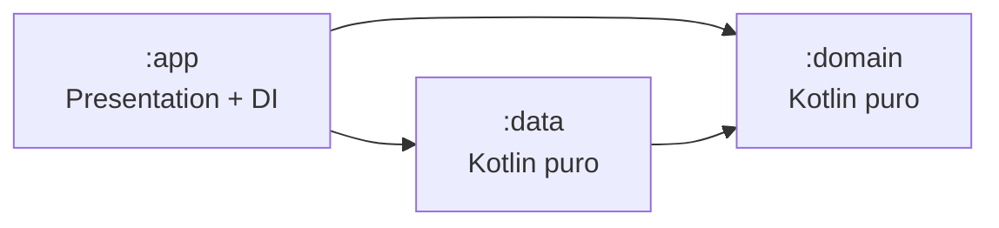

# Watchly

[](https://github.com/marcospoloc/Watchly/actions/workflows/ci.yml)
[](LICENSE)


App Android para buscar series de TV y ver su detalle. Está hecha con Jetpack Compose, Clean Architecture, corrutinas y Flow, y tiene una caché en memoria con expiración.

<!--
## Capturas

| Búsqueda | Detalle | Error |
|---|---|---|
|  |  |  |
-->


## API pública: TVMaze

[TVMaze](https://www.tvmaze.com/api) es gratuita, no necesita API key y responde JSON limpio, así que el proyecto se puede clonar y ejecutar sin configurar nada.

| Uso | Endpoint |
|---|---|
| Búsqueda | `GET https://api.tvmaze.com/search/shows?q={query}` |
| Detalle | `GET https://api.tvmaze.com/shows/{id}` |

El detalle muestra póster, géneros, valoración, fecha de estreno, cadena, idioma, estado, duración y sinopsis.

## Cómo ejecutarlo

Requisitos: JDK 17 y el Android SDK (API 36). Android Studio es opcional.

```bash
./gradlew assembleDebug              # compilar el APK
./gradlew installDebug               # instalar en un emulador o dispositivo conectado
./gradlew test                       # tests unitarios (domain, data, app)
./gradlew connectedDebugAndroidTest  # tests de accesibilidad en Compose (necesita emulador)
./gradlew ktlintCheck detekt         # estilo y análisis estático
./gradlew lintDebug                  # Android Lint
./gradlew assembleRelease            # build release con R8 (minificación y shrinking de recursos)
```

El CI de GitHub Actions ejecuta lo mismo en cada push y pull request: `ktlintCheck detekt test assembleDebug assembleRelease lintDebug`. En cada push a `main` también envía el grafo de dependencias resuelto a GitHub, para que Dependabot avise de vulnerabilidades conocidas, incluidas las de dependencias transitivas.

Si no usas Android Studio, crea `local.properties` con `sdk.dir=/ruta/al/Android/sdk`.

## Arquitectura

Es Clean Architecture con tres módulos Gradle y MVVM con flujo unidireccional (UDF) en la capa de presentación.



`:app` depende de `:data` solo para llamar a `createShowRepository(...)` en el *composition root*; todo lo demás de `:data` es `internal`.

| Módulo | Tipo | Contenido |
|---|---|---|
| `:domain` | Kotlin/JVM puro | Modelos (`Show`, `ShowDetail`), contrato `ShowRepository`, casos de uso, `Outcome` y `DomainError` |
| `:data` | Kotlin/JVM puro | API Retrofit, DTOs, mappers, `InMemoryCache` y `ShowRepositoryImpl` |
| `:app` | Android | ViewModels, pantallas Compose, navegación, theme y módulo Hilt |

### Por qué estas decisiones

- **Módulos Gradle en vez de paquetes.** El compilador garantiza la regla de dependencia: `:domain` no puede importar Retrofit ni Android porque no están en su classpath. Además, los tests de `:domain` y `:data` son JVM puros y rápidos.
- **Domain y data sin framework.** Ninguno de los dos depende de Hilt. Todo se ensambla en `app/di/AppModule.kt`, que hace de *composition root*. `:data` solo expone `createShowRepository(...)`; la API, los DTOs y la implementación son `internal`.
- **Inversión de dependencias.** `ShowRepository` lo define el dominio y lo implementa data.
- **Casos de uso aunque sean finos.** Son el único sitio donde viven las reglas de negocio: normalizar la query y no llamar a red si la query está en blanco.
- **Errores tipados.** `Outcome<T>` = `Success | Failure(DomainError)`. Ninguna excepción de infraestructura cruza de una capa a otra.
- **MVVM + UDF, sin MVI completo.** Cada ViewModel expone un único `StateFlow` de un `UiState` sellado (`Idle | Loading | Success | Empty | Error`), sin booleanos sueltos. Un MVI con reducers sería demasiada ceremonia para dos pantallas.
- **Hilt.** Errores de DI en tiempo de compilación e integración oficial con ViewModel, `SavedStateHandle` y Navigation Compose.

### Decisiones registradas (ADR)

| ADR | Decisión |
|---|---|
| [0001](docs/adr/0001-modulos-domain-y-data-en-kotlin-puro.md) | Módulos `:domain` y `:data` en Kotlin puro, ensamblados en `:app` |
| [0002](docs/adr/0002-cancelacion-de-busquedas-con-flatmaplatest.md) | Cancelación de búsquedas obsoletas con `flatMapLatest` |
| [0003](docs/adr/0003-cache-en-memoria-y-errores-tipados.md) | Caché en memoria con TTL y errores tipados con `Outcome` |
| [0004](docs/adr/0004-actualizacion-de-dependencias-sin-agp-9.md) | Actualización de dependencias sin migrar a AGP 9 |

## Concurrencia y cancelación

`SearchViewModel`:

```kotlin
_query
    .debounce(SEARCH_DEBOUNCE)      // 300 ms: espera a que el usuario deje de escribir
    .map { it.trim() }
    .distinctUntilChanged()         // "lost" y "lost " no lanzan otra búsqueda
    .combine(retryRequests) { q, _ -> q }
    .flatMapLatest(::searchStates)  // cancela la búsqueda anterior
    .stateIn(viewModelScope, WhileSubscribed(5_000), Idle)
```

- **`flatMapLatest`** cancela la corrutina de la búsqueda anterior en cuanto llega una query nueva. Las funciones `suspend` de Retrofit son cancelables, así que la petición HTTP en curso también se cancela y es imposible que lleguen a la UI resultados de una búsqueda vieja.
- **`CancellationException` nunca se captura.** `safeApiCall` la vuelve a lanzar. Si se tragara, una búsqueda cancelada se convertiría en un error falso y se rompería la concurrencia estructurada.
- **El debounce** reduce las peticiones y nos mantiene dentro del límite de TVMaze (20 peticiones cada 10 s).
- **El test** `SearchViewModelTest` comprueba que una búsqueda lenta ("lost") se cancela cuando llega "house" y que solo se emite el resultado de "house". Si se sustituye `flatMapLatest` por `flatMapConcat`, el test falla.

## Caché

`InMemoryCache<K, V>(ttl, timeSource)` con TTL de 3 minutos (`DEFAULT_CACHE_TTL`).

- **Cache-first.** Si hay un valor válido, se devuelve sin llamar a red. Si ha caducado o no existe, se pide a red, se guarda y se devuelve.
- **Clave normalizada.** Se usa `trim().lowercase()`, así que "Lost" y " lost " comparten entrada.
- **Los errores no se cachean.** El siguiente intento vuelve a la red.
- **Tiempo inyectado (`kotlin.time.TimeSource`).** En producción se usa el reloj monotónico, que no se ve afectado si el usuario cambia la hora del dispositivo. En los tests se usa `TestTimeSource`, de modo que la expiración se prueba de forma determinista y sin `sleep`.
- **Thread-safe** con `Mutex`.
- **El detalle también se cachea por id.** Volver a abrir una serie no repite la petición.
- **Límite conocido.** Dos búsquedas idénticas simultáneas con la caché vacía pueden hacer dos peticiones. Con el debounce y `distinctUntilChanged` no ocurre en la práctica, y deduplicarlas añadiría complejidad.

## Accesibilidad (prioridad en UI/UX)

- **Contraste WCAG AA** con una paleta propia clara y oscura. No se usa *dynamic color* para no perder el contraste verificado.
- **Fuente escalable.** Todo en `sp` y sin alturas fijas en texto. Se ha probado con la fuente al 200 % en el emulador.
- **TalkBack:**
  - Cada resultado es **un único foco**, con título, año, géneros y valoración, más la acción "ver detalle".
  - La valoración se lee como "Valoración 8,3 de 10", no como "estrella, 8,3".
  - Los títulos y secciones se marcan como `heading()` para poder navegar por encabezados.
  - Las filas de información se leen como "Cadena, ABC" en un solo foco.
  - Los iconos decorativos tienen `contentDescription = null`. El póster del detalle está descrito.
- **Cambios de estado anunciados** con `liveRegion`: "10 resultados", "Buscando…", "Sin resultados…" y los errores.
- **Campo de búsqueda** con *label* visible (no solo placeholder), botón "Borrar búsqueda" descrito, `ImeAction.Search` y foco inicial solo la primera vez.
- **El color no es el único indicador.** Los errores llevan icono, texto y botón "Reintentar".
- **Géneros como etiquetas no interactivas.** Un `Chip` se anunciaría como un botón que no hace nada.
- **Textos en `strings.xml`** en inglés (por defecto) y en español, con plurales.
- **Layout adaptativo.** Una columna en móvil y cuadrícula en pantallas anchas. El contenido del detalle tiene un ancho máximo para que se lea bien.
- **Tests de semántica en Compose** (`androidTest`): el ítem es un botón con etiqueta de acción y el título es un encabezado.

## Tests

| Capa | Tests | Qué cubren |
|---|---|---|
| Domain (MockK) | `SearchShowsUseCaseTest`, `GetShowDetailUseCaseTest` | Delegación, normalización, que una query en blanco no llama al repositorio y propagación de errores |
| Data | `InMemoryCacheTest` | Valor válido dentro del TTL, expiración en el límite exacto, claves independientes y renovación del TTL al sobrescribir |
| Data | `ShowRepositoryImplTest` | Acierto de caché sin red, clave normalizada, expiración que vuelve a red y actualiza la caché, errores no cacheados y mapeo de 404/500/IO |
| Data | `ShowMapperTest` | Campos nulos, HTML → texto plano, año y `webChannel` |
| Presentation (Turbine) | `SearchViewModelTest` | Idle, debounce, **cancelación**, vacío, reintento y borrado de la búsqueda |
| Presentation | `DetailViewModelTest` | Lee el id de navegación, error y reintento |
| UI (instrumentado) | `ShowListItemAccessibilityTest` | Semántica accesible |

Hay 33 tests unitarios y 2 instrumentados.

## Stack

Kotlin 2.3 · Compose (Material 3, BOM 2026.06) · Navigation Compose type-safe · Hilt · Coroutines/Flow · Retrofit + kotlinx.serialization · OkHttp · Coil · JUnit4 · MockK · Turbine · kotlinx-coroutines-test · ktlint · detekt · R8.

Las versiones exactas están en [`gradle/libs.versions.toml`](gradle/libs.versions.toml). El [ADR 0004](docs/adr/0004-actualizacion-de-dependencias-sin-agp-9.md) explica por qué algunas no son la última disponible.

## Qué haría con más tiempo

- Migrar a AGP 9, lo que desbloquea las últimas versiones de AndroidX, Compose, Hilt y Kotlin (ver ADR 0004).
- Caché persistente con Room (*stale-while-revalidate*) para tener modo offline.
- Paginación y deduplicación de peticiones simultáneas en vuelo.
- Tests de screenshot (Paparazzi o Roborazzi) en claro, oscuro y con fuente al 200 %.

## Licencia

[MIT](LICENSE)
